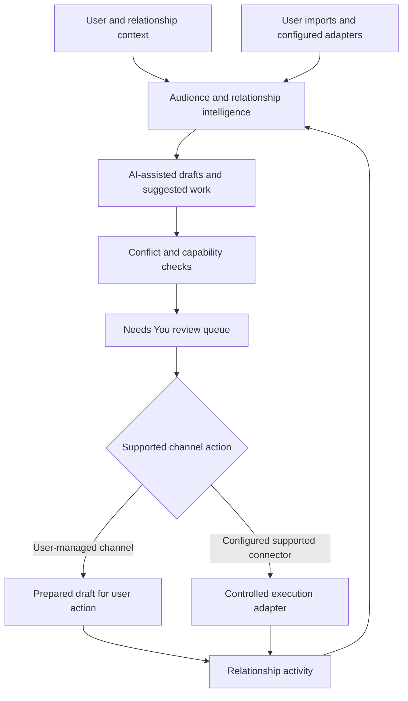

# Personea — AI Relationship & Network Intelligence

Personea is an AI-assisted relationship and network-growth platform that helps users decide who to engage, why they matter, and what to say, while keeping outreach actions under human control.

## Product

Personea helps founders and operators understand their network, define audiences, prepare outreach, review decisions, and manage relationship workflows. People and relationship context are central; campaigns are not the sole organizing unit.

## Problem

An outreach system can generate a plausible message while missing relationship context, conflicting activity, user preferences, or the channel’s actual permissions. Useful relationship intelligence must preserve control over contact and distinguish a draft from an executable action.

## What I Built

I designed and built the relationship model, audience interpretation, prioritization, approval experience, and adapter-based execution architecture. The implemented system includes person-centric records, explainable scoring, comment opportunities, a “Needs You” queue, execution gates, OAuth flows, and official LinkedIn export ingestion.

## What This Demonstrates

Human-in-the-loop AI · relationship modeling · context-aware generation · capability-based integration design · conflict checks · channel-aware product architecture · user-controlled execution.

## Architecture

This diagram shows product and service boundaries, not infrastructure topology or database structure.

## Technical Stack

Next.js · React · TypeScript · Tailwind CSS · Supabase Auth/Postgres · Vercel AI SDK · OpenAI provider adapter · Zod · Vitest. Stripe-related entitlement infrastructure is present; completed live billing is not asserted.

## Engineering Decisions

### 1. Make the person the central object

Relationship history, relevance, timing, and overrides inform recommendations. This supports ongoing relationship work rather than treating every contact as a row in a one-off send campaign.

### 2. Separate intelligence from channel implementations

Provider contracts and development adapters let domain workflows and tests run independently of external services. Production connectors are integrated according to each platform’s actual API and permission model.

### 3. Use a central execution gate

The gate checks pauses, contact restrictions, conflicting activity, granted capabilities, execution mode, and approval policy before outbound work. Permission to generate a draft is separate from permission to execute an action.

### 4. Design LinkedIn around a truthful capability boundary

The production LinkedIn adapter supports identity-oriented integration and user-provided official connection exports. It directs users to send prepared messages or connection notes on LinkedIn rather than claiming unsupported automatic sending.

### 5. Treat review and dry runs as product features

The approval queue, conflict explanations, and dry-run settings make proposed work visible and controllable. They also provide a testable boundary while channel integrations are configured.

## Production Considerations

The code includes workspace-aware persistence, authenticated OAuth paths, webhook handling, structured AI schemas, execution restrictions, and Vitest tests for imports, conflict handling, and workflow phases. Development adapters support repeatable testing without live social accounts. Production connector code is present for selected channels, but live account connectivity was not exercised during this audit.

## Current Implementation and Direction

Current implementation includes relationship intelligence, review workflows, and channel gates. LinkedIn sending remains a user action. The adapter architecture supports further integrations; an adapter contract or entitlement foundation does not establish a shipped connection or live billing service.

<!-- Add sanitized product screenshot here -->

## Source Policy

The commercial application is maintained privately. This case study explains its engineering boundaries without publishing implementation source, relationship records, account credentials, private prompts, database structures, or security-sensitive details.
